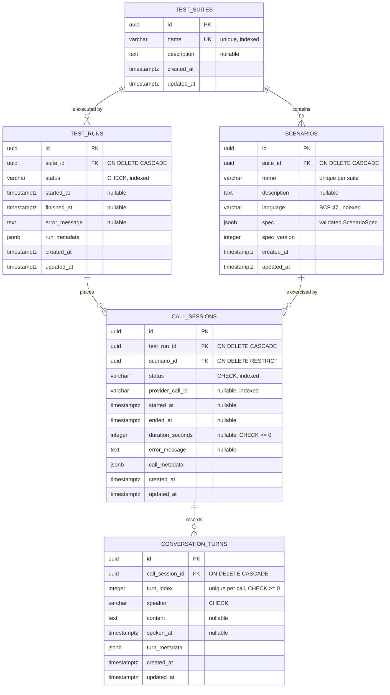

# Database Architecture

PostgreSQL 16, accessed through SQLAlchemy 2.x typed declarative ORM, with the
schema owned entirely by Alembic.

> **Scope.** Phase 2 creates all five tables. Only `test_suites` and
> `scenarios` are written to by the API. `test_runs`, `call_sessions` and
> `conversation_turns` are **foundational schema**: they exist so later phases
> have a stable shape to write into, and nothing in this phase creates a row
> in them.

---

## Entity relationships



A suite holds many scenarios and is executed by many runs. Each run places one
call per scenario, and each call records an ordered sequence of turns.

---

## Tables

### `test_suites`

A named collection of scenarios that are run together.

`name` is unique globally. There is no tenant or owner concept yet; when one
arrives this becomes a composite constraint rather than a new column.

### `scenarios`

One test case. The validated specification is stored as a single JSONB
document in `spec`.

`spec` carries a **GIN index** (`ix_scenarios_spec_gin`) so the library's tag
filter is an index scan rather than a sequential one. See below.

### `test_runs`, `call_sessions`, `conversation_turns`

Foundational. See the scope note above.

`conversation_turns.turn_index` is stored explicitly and unique per call
rather than relying on `created_at` ordering — two turns can share a timestamp
at the resolution the database stores, and a transcript rendered in the wrong
order is worse than useless.

---

## Schema decisions

### Why the scenario spec is one JSONB column, not five tables

The specification is a nested document — persona, goal, known facts, expected
outcomes, audio settings, constraints — that is always read and written whole,
is never queried field-by-field, and will keep gaining fields as later phases
add capabilities. Normalising it would mean five more tables and a migration
for every new scenario option, with no query benefit.

It is **not** an unvalidated bag of values. Every write passes through
`ScenarioSpec` (`backend/app/schemas/scenario_spec.py`), which forbids unknown
keys and range-checks every number. JSONB is the storage format; Pydantic is
the schema.

`spec_version` records which revision of that schema produced the stored
document, so a future schema change can migrate old rows rather than guess at
their shape. It is currently `2`: v2 added the optional `tags` and
`code_mixing` fields, both with defaults, so a stored v1 document still
validates unchanged. No data migration was needed, and a v1 row keeps its
recorded version until it is next written.

### Why `spec` has a GIN index

Tag filtering (`GET /api/v1/scenarios?tag=healthcare`) is a JSONB containment
test — `spec @> '{"tags": ["healthcare"]}'`. B-tree indexes cannot answer
containment, so without a GIN index every tag query is a sequential scan of
the whole table that deserialises each document.

```sql
CREATE INDEX ix_scenarios_spec_gin ON scenarios USING gin (spec);
```

`EXPLAIN` on a tag filter shows a Bitmap Index Scan on this index, which is
the behaviour the index exists to produce.

The index covers the whole `spec` column rather than a `jsonb_path_ops`
expression index on `tags` alone. That is deliberate: later phases will filter
on other parts of the document, and a general index serves those without
another migration. The cost is a larger index and slightly slower writes —
acceptable for a table that is written once per authored scenario and read on
every library query.

This is also why the tag filter is a containment test rather than SQL
generated from a list of `LIKE` patterns: containment requires every requested
tag to be present, which is the semantics the endpoint documents, and it is
the form the index can answer.

### Why `name`, `description` and `language` are duplicated out of the spec

Those three are the fields the API filters, sorts and enforces uniqueness on —
none of which a JSONB document does efficiently. They are a projection of the
spec, written in exactly one place (`_spec_to_columns` in
`scenario_service.py`) so the two cannot drift.

### Why a constraint naming convention

`Base.metadata` carries an explicit `naming_convention`. Without it,
PostgreSQL invents names for unnamed constraints and Alembic cannot reliably
drop them in a downgrade — the usual cause of migrations that only go one way.

### Why enums are CHECK-constrained VARCHARs

A PostgreSQL `ENUM` type cannot have a value removed and needs DDL to add one,
which makes it awkward to migrate. `Enum(..., native_enum=False)` stores a
VARCHAR instead.

`create_constraint=True` is **required, not decorative**: SQLAlchemy defaults
it to `False`, which would leave the column a plain VARCHAR whose allowed
values are enforced only in Python — so any write bypassing the ORM could
store nonsense. A test inserts an invalid status with raw SQL to pin this.

### Why `ON DELETE RESTRICT` on `call_sessions.scenario_id`

Everything cascades from its suite, with one exception: a scenario that has
been exercised by a recorded call cannot simply vanish, or that call's result
becomes uninterpretable. Deleting such a scenario is a deliberate act that
must deal with its history first, so the API returns 409 rather than silently
orphaning results.

### Why UUID primary keys

`default=uuid.uuid4` is a Python-side column default: SQLAlchemy evaluates it
when the INSERT is emitted and sends the value as a bound parameter, so no
`RETURNING` round-trip is needed and no database extension is relied on. Note
the attribute is populated at **flush** time, not at construction.

The column is a native `uuid`, not a string, so comparisons and indexes use 16
bytes rather than 36 characters.

### Why timestamps are `timestamptz`

`DateTime(timezone=True)` stores absolute instants rather than ambiguous
wall-clock readings. Both defaults are evaluated by the database (`now()`), so
timestamps stay consistent even if application servers disagree about the
time.

### Relationship loading

| Relationship | Strategy | Why |
|---|---|---|
| `Scenario.suite` | `joined` | Always needed when a scenario is serialised |
| `TestSuite.scenarios` | `select` (lazy) | No endpoint serialises them inline; the suite detail response uses a SQL `COUNT`, and the scenario list is its own paginated endpoint |
| `TestSuite.test_runs` | `raise_on_sql` | Grows without bound; an accidental access should fail loudly in development rather than quietly degrade in production |
| `CallSession.*`, `ConversationTurn.*` | `raise_on_sql` | Same reasoning |

`passive_deletes=True` lets the database's `ON DELETE CASCADE` do the work
instead of SQLAlchemy loading every child row first.

### Sessions are synchronous

Phase 1 established the `postgresql+psycopg` (sync) URL, Alembic runs
synchronously, and FastAPI runs a `def` handler in a worker thread — so a
synchronous session does not block the event loop. An async engine would add a
second concurrency model, a greenlet dependency and async-aware migrations for
no present benefit. The repository layer is thin enough that switching later
is mechanical.

`get_db` rolls back and closes in a `finally`, so a handler that raises cannot
leak a connection or return one to the pool still inside a transaction.

---

## Migrations

Alembic owns the schema. **The application never calls `create_all()`**, so
what runs in development is the same thing that will run anywhere else.

`alembic.ini` lives in `backend/` rather than the repository root so that it is
present inside the Docker image, which copies only `backend/`. Run Alembic
from that directory.

### Commands

```bash
cd backend

alembic upgrade head           # apply all pending migrations
alembic current                # show the applied revision
alembic history --verbose      # list revisions
alembic downgrade -1           # undo the most recent migration
alembic downgrade base         # undo everything
alembic check                  # fail if models and migrations have drifted
alembic upgrade head --sql     # print the SQL without running it
```

Inside Docker:

```bash
docker compose exec backend alembic upgrade head
docker compose exec backend alembic current
```

### Adding a migration

```bash
cd backend
alembic revision --autogenerate -m "short description"
```

Then **read the generated file**. Autogenerate is a starting point, not an
oracle: it misses table and column renames (it emits a drop plus an add, which
loses data), and it cannot know about data backfills.

A `post_write_hooks` entry runs `ruff format` and `ruff check --fix` on the
generated file, so a migration cannot be the one file that fails CI.

Add the new model to `app/models/__init__.py` first, or autogenerate will not
see it.

### The database URL

`env.py` reads the URL from application settings, not from `alembic.ini`, so a
password never has to be written into a committed file and migrations always
target whatever the application itself would connect to.

> **Check the port.** `DATABASE_URL` and `POSTGRES_HOST_PORT` can disagree. If
> they do, `alembic upgrade head` run from the host will connect to whatever
> else is listening on the old port — possibly another project's database.

### Current revisions

| Revision | Description |
|----------|-------------|
| `3e3312d5327a` | Create the suite, scenario and execution tables (initial) |
| `4997650a09c8` | Index `scenarios.spec` with GIN for tag filtering |

Both are reversible. The initial migration's `downgrade()` drops everything in
reverse dependency order and is exercised on every test run, so it is
genuinely reversible rather than one-way; `4997650a09c8` drops its index.

Phase 3 added the `tags` and `code_mixing` fields without a data migration:
they live inside the existing JSONB document and are optional with defaults,
so no existing row had to be rewritten. The only schema change was the
index.

**Phase 4 added no tables, columns or migrations**, and that was a decision
rather than an omission. Speech-to-text is stateless here: a transcript
belongs to a conversation turn, and deciding *which* turn is conversation
orchestration — Phase 9. Adding a `transcripts` table now would mean guessing
its foreign keys before anything writes to it, and a table written by nothing
is schema guesswork that a later phase has to undo.

Two consequences worth knowing. The transcription endpoints open no session,
so they keep working with PostgreSQL down. And `TestRun`, `CallSession` and
`ConversationTurn` remain foundational schema with nothing writing to them —
exactly as after Phase 2.
